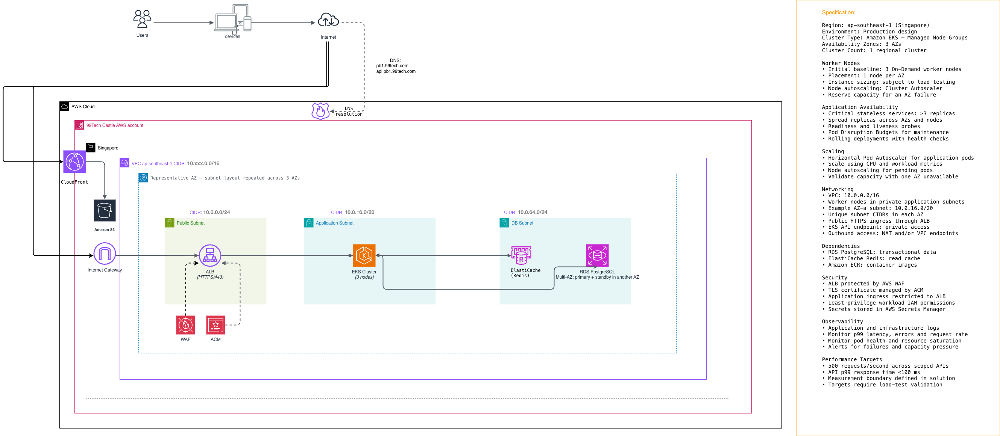
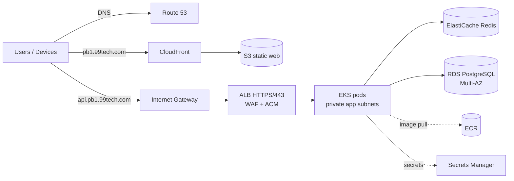

# Problem 1: Building Castle In The Cloud — Solution

> A highly available, scalable and cost-effective trading platform (Binance-like) on AWS, sized for **500 requests/second** with **p99 < 100 ms**.



---

## 1. Scope

The full Binance feature set is out of scope. This design covers the features that exercise the hard infrastructure problems: low latency reads, consistent writes, and failure isolation.

## 2. Architecture Overview

### 2.1 Request flows



1. **DNS:** Route 53 resolves `pb1.99tech.com` to CloudFront and `api.pb1.99tech.com` to the ALB (alias records). Health checks run on both.
2. **Static web:** The browser loads the SPA from CloudFront. S3 is private and reachable only through CloudFront Origin Access Control (OAC).
3. **API:** Requests enter through the Internet Gateway and reach the **ALB** in the public subnets. **AWS WAF** filters them (rate limits, managed rule groups), and TLS terminates with an **ACM** certificate.
4. **Application:** The ALB forwards to pods on **EKS** worker nodes in the **private application subnets**. It uses IP target mode through the AWS Load Balancer Controller.
5. **Data:** Pods read hot data from **ElastiCache Redis** and do transactional reads and writes against **RDS PostgreSQL Multi-AZ** in the **isolated DB subnets**.
6. **Egress:** Nodes reach AWS APIs through **VPC endpoints** (ECR, S3, Secrets Manager, STS, CloudWatch Logs). Anything else goes out through a **NAT Gateway per AZ**.

### 2.2 Network layout

The VPC is `10.0.0.0/16` in `ap-southeast-1`. The subnet layout in the diagram's "representative AZ" repeats in all 3 AZs with unique CIDRs:

| Tier | ap-southeast-1a | ap-southeast-1b | ap-southeast-1c | Route |
|---|---|---|---|---|
| Public (ALB, NAT GW) | `10.0.0.0/24` | `10.0.1.0/24` | `10.0.2.0/24` | `0.0.0.0/0` → IGW |
| Application (EKS nodes/pods) | `10.0.16.0/20` | `10.0.32.0/20` | `10.0.48.0/20` | `0.0.0.0/0` → NAT GW (same AZ) |
| DB (RDS, ElastiCache) | `10.0.64.0/24` | `10.0.65.0/24` | `10.0.66.0/24` | No internet route |

- The application subnets are `/20` (4,091 usable IPs each) because the VPC CNI gives every pod a VPC IP. This leaves headroom for scaling without re-IPing. Prefix delegation can be enabled later for density.
- `10.0.128.0/17` stays free for future tiers (e.g. MSK, dedicated matching-engine subnets).

### 2.3 Security group chain

```
Internet ──443──▶ sg-alb ──app port──▶ sg-eks-nodes ──5432──▶ sg-rds
                                           └─────────6379──▶ sg-redis
```

Each tier accepts traffic **only from the security group of the tier in front of it**, so nothing bypasses the ALB to reach the application. The EKS API endpoint is **private**, and administrators reach it through VPN/SSM.

---

## 3. Service Choices & Alternatives

| Layer | Chosen service | Why | Alternatives considered | Why not (for now) |
|---|---|---|---|---|
| DNS | **Route 53** | Native alias records to CloudFront/ALB, health checks, 100% SLA, failover routing ready for DR | Cloudflare DNS | An extra vendor; loses native alias/health-check integration |
| Edge / static | **CloudFront + S3 (OAC)** | Global edge cache for the SPA, offloads static traffic from the cluster, cheap | Amplify Hosting; serving static files from EKS | Amplify adds less control; serving from EKS wastes compute and adds latency |
| DDoS / L7 protection | **AWS WAF** on ALB (+ Shield Standard) | Managed rules (OWASP, bad IPs), rate-based rules per IP/API key | Shield Advanced; third-party WAF | Shield Advanced costs ~$3k/month: justified once the platform is a DDoS target at scale |
| TLS | **ACM** | Free public certs, auto-renewal, native to ALB/CloudFront | Let's Encrypt + cert-manager | Manual rotation on the ALB; ACM is simpler |
| Load balancer | **Application Load Balancer** | L7 routing by path/host, HTTPS, WebSocket support (market streams), WAF integration, cross-AZ | NLB; API Gateway | NLB has no WAF/L7 routing. API Gateway adds per-request cost and latency, and its 29 s timeout hurts long-lived streams |
| Compute | **Amazon EKS — Managed Node Groups** | Standard Kubernetes for many microservices (market, order, account), HPA/PDB/rolling updates, portable, rich ecosystem | ECS on Fargate; ECS on EC2; Lambda | ECS is simpler but has a smaller ecosystem. Fargate cold scaling and per-vCPU cost are higher. Lambda cold starts threaten p99 < 100 ms and it has no long-lived connections |
| Node scaling | **Cluster Autoscaler** | Mature, predictable with managed node groups (per spec) | Karpenter | Karpenter is faster and better at bin-packing. It is planned for Phase 2 (§7) |
| Cache | **ElastiCache for Redis** (cluster, Multi-AZ, auto-failover) | Sub-millisecond reads for ticker/order book/balances, pub/sub for stream fan-out | DAX; Memcached; self-hosted Redis on EKS | DAX is DynamoDB-only. Memcached has no replication or failover. Self-hosting adds ops burden |
| Database | **RDS for PostgreSQL Multi-AZ** | ACID transactions for orders/balances, synchronous standby in another AZ, automated backups + PITR | Aurora PostgreSQL; DynamoDB; self-managed Postgres | Aurora gives faster failover and 15 replicas at a higher base cost: the Phase 2 upgrade. DynamoDB makes multi-row balance/order transactions and ad-hoc queries harder |
| Container registry | **Amazon ECR** | Private, IAM-integrated, image scanning, VPC endpoint pulls | Docker Hub; GHCR | Rate limits, public egress, weaker IAM integration |
| Secrets | **AWS Secrets Manager** + External Secrets Operator / CSI driver | Automatic RDS credential rotation, KMS encryption, auditable | SSM Parameter Store; HashiCorp Vault | Parameter Store has no native rotation. Vault is powerful but another cluster to operate |
| Workload IAM | **EKS Pod Identity / IRSA** | Least-privilege, per-service IAM roles, no static keys | Node instance role | Every pod would share broad permissions |
| Observability | **CloudWatch Container Insights + Amazon Managed Prometheus + Managed Grafana + X-Ray (ADOT)** | Managed metrics/logs/traces, p99 per route, no monitoring stack to run | Self-hosted Prometheus/Loki; Datadog | Self-hosting adds ops toil. Datadog is excellent but costly at scale |

---

## 4. High Availability

### 4.1 Infrastructure

- **3 AZs everywhere:** the ALB, NAT Gateways, EKS node groups, Redis replicas and RDS standby are all spread across AZs.
- **EKS control plane** is AWS-managed and runs across multiple AZs.
- **Worker nodes:** a baseline of 3 On-Demand nodes, **one per AZ**. Capacity is sized as **N+1 by AZ**: if any one AZ fails, the remaining two carry 100% of peak load (§5.3).
- **RDS Multi-AZ:** a synchronous standby runs in a different AZ, with automatic failover (typically 60–120 s) and the same DNS endpoint.
- **ElastiCache:** primary + replicas across AZs with automatic failover. The application treats Redis as a **cache, not a source of truth**: on a Redis failure it degrades to PostgreSQL reads and does not error.
- **NAT Gateway per AZ**, so one AZ outage does not cut egress for the others.

### 4.2 Application

| Control | Configuration |
|---|---|
| Replicas | Critical stateless services run **≥ 3 replicas** |
| Spreading | `topologySpreadConstraints` on `topology.kubernetes.io/zone` and `kubernetes.io/hostname` (`maxSkew: 1`) |
| Probes | Readiness probes gate ALB traffic; liveness probes restart hung processes; startup probes cover JVM/warm-up |
| PodDisruptionBudget | `minAvailable: 2` (or `maxUnavailable: 1`) so node drains and upgrades never take a service below quorum |
| Rollouts | Rolling updates (`maxUnavailable: 0`, `maxSurge: 25%`) with ALB health checks; automatic rollback on failed readiness |
| Graceful shutdown | `preStop` sleep + ALB deregistration delay so in-flight requests finish |
| Idempotency | `POST /order` requires a client order ID, so retries after a timeout or failover never create duplicate orders |
| Timeouts & retries | Tight client timeouts (Redis 50 ms, DB 200 ms) with bounded, jittered retries and circuit breakers to prevent cascades |

### 4.3 Failure scenarios

| Failure | Impact | Mitigation |
|---|---|---|
| A pod crashes | None visible | Readiness removes it from the ALB; ReplicaSet replaces it |
| A node fails | Brief capacity dip | Pods reschedule; Cluster Autoscaler replaces the node; PDB and spreading keep ≥ 2 replicas serving |
| A whole AZ fails | ~1/3 capacity lost for minutes | The ALB stops routing to that AZ; the other two AZs are pre-sized for 100% load; RDS/Redis fail over to the other AZs |
| RDS primary fails | Writes pause ~1–2 min | Multi-AZ automatic failover; idempotent retries; reads continue from Redis |
| Redis primary fails | Higher latency for seconds | Replica promotion; the app falls back to PostgreSQL |
| Bad deployment | Partial errors | Rolling update halts on failed readiness; one-command rollback (Argo CD/Helm) |
| L7 attack / bot flood | Possible saturation | WAF rate-based rules, managed rule groups, per-API-key throttling |
| Region failure | Full outage (accepted for v1) | Cross-region backups enable restore; Phase 3 adds warm-standby DR (§7) |

**Backup & recovery:** RDS automated backups with point-in-time recovery (7–35 days), daily snapshots copied cross-region with AWS Backup, and S3 versioning. Initial targets: **RPO ≤ 5 min, RTO ≤ 1 hour** for a regional disaster; **RPO ≈ 0, RTO ≤ 2 min** for AZ failures.

---

## 5. Performance: 500 RPS at p99 < 100 ms

### 5.1 Measurement boundary

p99 is measured **at the ALB** (`TargetResponseTime` plus ALB processing), from the moment the request reaches the ALB until the response leaves it. The client's internet RTT is excluded because the platform does not control it; it is tracked separately with synthetic canaries (CloudWatch Synthetics) from Singapore.

### 5.2 Latency budget (p99)

| Hop | Budget |
|---|---|
| WAF + ALB + TLS | ≤ 10 ms |
| Pod processing (routing, auth, serialization) | ≤ 20 ms |
| Redis read (cache hit) | ≤ 3 ms |
| PostgreSQL query/transaction (indexed, pooled) | ≤ 30 ms |
| Safety margin (GC pauses, cross-AZ hops, retries) | ~37 ms |
| **Total** | **< 100 ms** |

Techniques that keep the budget:

- **Cache-first reads:** ticker, order book snapshots and klines are served from Redis and refreshed by write-through/pub-sub, not per-request DB queries.
- **Connection pooling:** PgBouncer or pooling in the app (RDS Proxy in Phase 2) avoids connection-setup latency.
- **Short write transactions:** order inserts and balance holds run in a single short transaction, backed by the right indexes (`user_id, created_at`), `SELECT … FOR UPDATE` only on the balance row, and no long locks.
- **Keep-alive** connections between the ALB and pods; HTTP/2 to clients.
- **Right-sized resources:** pods get CPU requests that avoid throttling, because CFS throttling is a common hidden p99 killer.

### 5.3 Capacity sizing (initial, to be confirmed by load test)

- **Peak target:** 500 RPS, planned at **1,000 RPS (2× headroom)** for bursts.
- **AZ-failure rule:** any 2 AZs must handle 1,000 RPS, so each AZ is sized for ~500 RPS.
- **Starting point:** 3 × `m7g.xlarge` (4 vCPU / 16 GiB, Graviton for price-performance), one per AZ. Each API pod runs at ~0.5 vCPU, and HPA scales out at **60% CPU** or on a custom requests-per-pod metric.
- **RDS:** `db.r7g.large` Multi-AZ with gp3 storage (provisioned IOPS if needed).
- **Redis:** `cache.r7g.large`, 1 primary + 2 replicas across AZs.

> These are starting values. The spec says instance sizing is **subject to load testing**, so the final sizes come from §5.4.


## 6. Security, Observability, Cost

### 6.1 Security

- WAF on the ALB (AWS managed rule groups, rate-based rules, geo/IP lists) and TLS 1.2+ with ACM.
- Private EKS API endpoint; nodes and data stores in private/isolated subnets; the security group chain from §2.3.
- Least-privilege **Pod Identity/IRSA** per service, Kubernetes RBAC, Pod Security Standards (`restricted`), and NetworkPolicies between namespaces.
- **Encryption:** KMS at rest for RDS, Redis, S3, EBS, ECR and EKS secrets; TLS in transit including Redis and Postgres.
- Secrets live in **Secrets Manager** with automatic RDS credential rotation, never in images or ConfigMaps.
- ECR image scanning, signed images, and an admission policy that allows only images from the private ECR.
- CloudTrail, GuardDuty (including EKS runtime monitoring) and Security Hub for detection and audit.

| Signal | Tooling | Key alerts |
|---|---|---|
| Golden signals per API | ALB metrics + Prometheus (AMP) + Grafana (AMG) | p99 > 80 ms for 5 min (warn), > 100 ms (page); 5xx > 0.5% |
| Logs | Fluent Bit → CloudWatch Logs (structured JSON, trace IDs) | Error-rate spikes, auth failures |
| Traces | ADOT → X-Ray | Slow spans by dependency (Redis/DB) |
| Pod & node health | Container Insights, kube-state-metrics | CrashLoopBackOff, pending pods > 2 min, node NotReady |
| Saturation | CloudWatch | CPU > 70%, RDS connections/CPU/replica lag, Redis memory/evictions, NAT bytes |
| Business | Custom metrics | Order placement rate, rejected orders, cache hit ratio < 70% |

SLOs (99.9% availability, p99 < 100 ms) are tracked with **error-budget burn-rate alerts** to keep pages actionable.

---

## 7. Scaling Beyond the Current Setup

| Phase | Trigger | Changes |
|---|---|---|
| **Phase 1 — Current** | ≤ 1k RPS | The architecture in this document |
| **Phase 2 — Growth** | ~1k–10k RPS, DB CPU > 60%, or connection pressure | See below |
| **Phase 3 — Scale** | 10k–100k+ RPS, global users, regulatory DR | See below |

### Phase 2 — Growth (~10× traffic)

- **Compute:** Karpenter replaces Cluster Autoscaler for faster, bin-packed, mixed On-Demand/Spot provisioning. Separate node pools isolate latency-critical services (order, market data) from background jobs.
- **Database:**
  - migrate RDS PostgreSQL to **Aurora PostgreSQL** (faster failover, up to 15 read replicas, storage autoscaling);
  - add **RDS Proxy** for connection pooling;
  - move history/reporting reads to replicas.
- **Cache:** ElastiCache **cluster mode** with sharding for horizontal scaling.
- **Event backbone:** **Amazon MSK (Kafka)** decouples order intake from downstream consumers (trade history, notifications, analytics, risk) and gives an ordered, replayable event log.
- **Real-time market data:** a dedicated **WebSocket gateway** service behind the ALB, fed by Redis pub/sub or Kafka, so streaming replaces polling.
- **Edge:** CloudFront in front of cacheable public market-data APIs (1–2 s TTL) to absorb read spikes.

### Phase 3 — Scale (~100× traffic, exchange-grade)

- **Matching engine:**
  - a dedicated in-memory, single-threaded matching engine **partitioned by trading pair**;
  - runs on network-optimized instances (`c7gn`) with placement groups;
  - its state is rebuilt deterministically from the Kafka log (event sourcing).
- **Data partitioning:** shard user/account data by `user_id` (Aurora Limitless or application-level sharding). Market history moves to a time-series/columnar store (e.g. Timestream, ClickHouse) and the data lake (S3 + Athena).
- **Cell-based architecture:** multiple independent EKS clusters/cells, each serving a subset of users or trading pairs, to limit the blast radius.
- **Multi-region DR:**
  - a warm standby in a second region (e.g. `ap-northeast-1`) with **Aurora Global Database** (RPO ≈ seconds) and ECR/S3 cross-region replication;
  - Route 53 failover routing, with **AWS Global Accelerator** for fast, health-based regional failover and lower global latency.
- **Security at scale:** Shield Advanced, Bot Control, and per-tier API rate limits.

---

## 8. Summary

- **Highly available:** 3-AZ design with N+1 AZ capacity, Multi-AZ RDS and Redis, PDBs, topology spread, and idempotent order APIs.
- **Scalable:** HPA for pods, Cluster Autoscaler (later Karpenter) for nodes, cache-first reads, and a clear path to Aurora, Kafka, sharding and multi-region.
- **Performant:** an explicit latency budget and measurement boundary, with targets validated by load and failure tests, not assumed.
- **Secure & cost-aware:** WAF/ACM at the edge, private data tiers, least-privilege IAM and Secrets Manager; Graviton, VPC endpoints, CloudFront offload and Savings Plans keep cost proportional to load.
