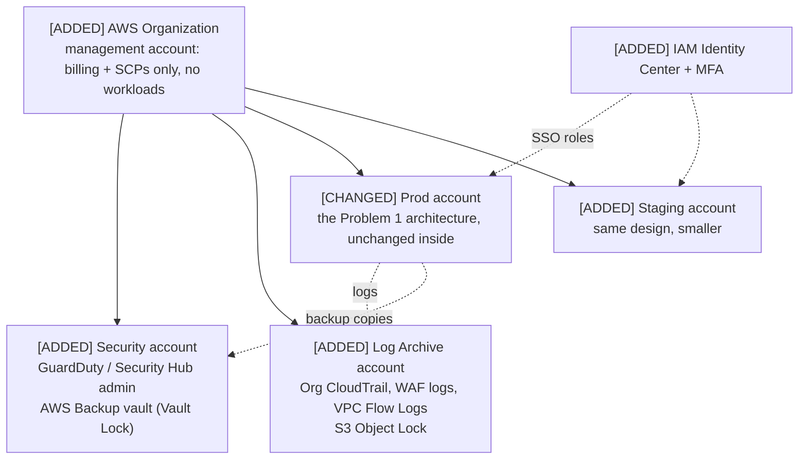

# Problem 5: Fortify The Castle

Problem 1 already built most security into the design: WAF and ACM on the ALB, private subnets, the security-group chain, a private EKS endpoint, Pod Identity, KMS encryption, Secrets Manager, CloudTrail and GuardDuty.

The biggest remaining risk is **one AWS account for everything**. A single leaked admin credential, or one bad script, can:

- reach production data;
- change networking;
- **delete the logs and backups that would be needed to recover**.

So my one design change is to **split the account with AWS Organizations**. Everything else I keep as it stood.

## Updated architecture

**Change in the Problem 1 drawio:** the single "99Tech Castle AWS account" box becomes the **Prod account** inside an **AWS Organization**, next to the Security, Log Archive and Staging accounts. Nothing inside the VPC changes.

## What changes and why

| Change | Protects against |
|---|---|
| **[ADDED] AWS Organizations** with separate Prod, Staging, Security and Log Archive accounts | Blast radius: a mistake or compromise in staging can't touch prod; prod admins can't erase the evidence |
| **[ADDED] SCPs** (guardrails no one in a member account can override): deny leaving the Org, deny disabling CloudTrail/GuardDuty/Config, deny root user, deny regions other than `ap-southeast-1` (global services exempted) | An attacker or admin turning off detection, or running resources in unexpected regions |
| **[ADDED] IAM Identity Center with MFA** for all human access; no IAM users or long-lived keys; monitored break-glass role | Leaked access keys, which are the most common way AWS accounts get compromised |
| **[ADDED] Org CloudTrail + WAF/VPC Flow Logs → Log Archive**, with S3 Object Lock | Logs altered or deleted after a breach |
| **[ADDED] Backup copies to a vault in the Security account** with Vault Lock | Ransomware or an insider deleting production backups |

## What I kept as it stood (risk accepted)

- **Public ALB with WAF + ACM + Shield Standard** for the API. It is good enough for launch. Moving the API behind CloudFront is deferred (see below).
- **Network design from Problem 1:**
  - 3-tier subnets and the security-group chain;
  - private EKS endpoint;
  - VPC endpoints.
- **Encryption and secrets:** KMS, Secrets Manager, Pod Identity.
- **One EKS cluster** shared by all services, isolated by namespaces.
- **Single region.**
- **User authentication** (login, MFA, API keys) is the application's own responsibility, so it is not part of the infrastructure design.

## Priorities

**Refuse to ship without:**

1. Prod in its own account under SCPs.
2. SSO + MFA for every human, with no long-lived keys.
3. Logs and backups stored where prod admins can't delete them.

**Do soon after launch:** an external penetration test, tuning WAF rate limits on login and order endpoints from real traffic, and cleaning up Security Hub findings.

**Deferred, with a trigger:**

| Deferred | Trigger |
|---|---|
| API behind CloudFront with a private ALB | Volumetric attacks on the ALB, or many users outside Singapore |
| Shield Advanced (~$3k/month) | First serious DDoS, or downtime cost exceeding the fee |
| Egress filtering (DNS Firewall / Network Firewall) | Compliance requirement or pentest finding |
| Multi-region DR | Regulatory requirement or a stricter RTO |

## Facts I don't have

| Need | How I'd get it | Assumed meanwhile |
|---|---|---|
| Regulatory regime (e.g. MAS in Singapore) and log retention | Legal / compliance team | Singapore-regulated; logs kept 5+ years |
| Whether we hold customer funds or crypto keys | Product / business owners | No custody in this phase. I would not ship withdrawals without a separate custody design |
| Team size for security operations | Engineering management | Small team, so AWS managed services first |

## Deliberately left out

- **Custody, deposits and withdrawals:** out of scope since Problem 1, and they need their own design.
- **Formal compliance mapping** (MAS TRM, PDPA, SOC 2): depends on the legal answers above.
- **Application-level security** (authentication, input validation): owned by the application teams.
